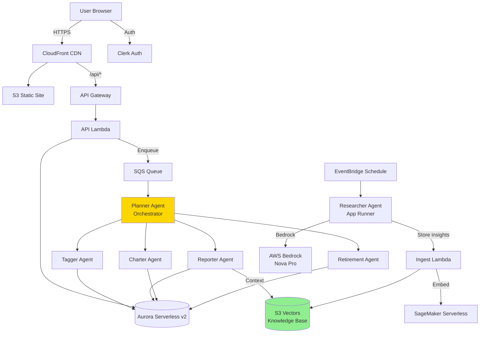

# Portfolio Pilot

AI-powered portfolio analysis and retirement planning, built as a team of specialized agents running on serverless AWS infrastructure.

Portfolio Pilot lets a user connect their investment accounts, then dispatches a crew of AI agents to analyze holdings, write a narrative report, build visualizations, project retirement outcomes, and continuously research markets in the background — all surfaced through a real-time web dashboard.

## Features

- **Multi-agent orchestration** — a planner agent coordinates four specialists (instrument tagging, report writing, charting, retirement projections) in parallel for each analysis request
- **Autonomous market research** — an independent research agent browses the web on a schedule and stores findings in a shared knowledge base for other agents to draw on
- **Cost-optimized vector search** — embeddings and similarity search run on S3 Vectors + SageMaker Serverless instead of a traditional vector database
- **Serverless backend** — Lambda, SQS, Aurora Serverless v2 (via the RDS Data API), API Gateway, and App Runner, all defined in Terraform
- **Modern web frontend** — NextJS + React dashboard with Clerk authentication, live agent-progress visualization, markdown reports, and interactive charts
- **Production practices** — CloudWatch dashboards/alarms, LangFuse observability, and guardrails on agent output

## Architecture



Each AI agent is a separate Lambda function built with the OpenAI Agents SDK, connected to AWS Bedrock via LiteLLM. The planner receives work over SQS, fans out to the specialist agents in parallel, and writes consolidated results back to Aurora for the frontend to display.

For more detail, see [guides/architecture.md](guides/architecture.md) (infrastructure) and [guides/agent_architecture.md](guides/agent_architecture.md) (agent collaboration patterns).

## Tech Stack

**Backend / Agents**
- Python 3.12, managed with [uv](https://docs.astral.sh/uv/)
- [OpenAI Agents SDK](https://github.com/openai/openai-agents-python) + [LiteLLM](https://docs.litellm.ai/) for agent orchestration against AWS Bedrock (Amazon Nova Pro)
- AWS Lambda, SQS, API Gateway, App Runner, Aurora Serverless v2 (Data API), S3 Vectors, SageMaker Serverless, EventBridge
- FastAPI (API layer)

**Frontend**
- Next.js 15, React 19, Tailwind CSS
- Clerk for authentication
- Recharts for data visualization

**Infrastructure**
- Terraform (one independent configuration per infrastructure area)
- Docker (for building Lambda deployment packages)

## Project Structure

```
.
├── backend/
│   ├── planner/        # Orchestrator agent
│   ├── tagger/          # Instrument classification agent
│   ├── reporter/        # Portfolio analysis agent
│   ├── charter/          # Visualization agent
│   ├── retirement/      # Retirement projection agent
│   ├── researcher/      # Market research agent (App Runner)
│   ├── ingest/           # Document ingestion / embedding Lambda
│   ├── database/        # Shared database access library
│   └── api/              # FastAPI backend consumed by the frontend
├── frontend/             # Next.js dashboard
├── terraform/
│   ├── 2_sagemaker/      # Embedding endpoint
│   ├── 3_ingestion/      # S3 Vectors + ingest Lambda + API Gateway
│   ├── 4_researcher/     # App Runner research service
│   ├── 5_database/       # Aurora Serverless v2
│   ├── 6_agents/         # Agent Lambdas + SQS orchestration
│   ├── 7_frontend/       # CloudFront, S3, API Gateway, API Lambda
│   └── 8_enterprise/     # Dashboards, alarms, enterprise hardening
└── scripts/               # Local dev and deployment helpers
```

## Prerequisites

- An AWS account with Bedrock model access granted for Amazon Nova Pro
- [AWS CLI](https://aws.amazon.com/cli/) configured with a user that has the necessary permissions
- [uv](https://docs.astral.sh/uv/) for running all Python code
- [Terraform](https://developer.hashicorp.com/terraform) 1.5+
- [Docker Desktop](https://www.docker.com/products/docker-desktop/) (for packaging Lambda functions)
- Node.js 20+
- A free [Clerk](https://clerk.com/) account (authentication)
- A free [polygon.io](https://polygon.io/) API key (real-time/EOD market prices)

## Getting Started

### 1. Configure environment variables

```bash
cp .env.example .env
```

Fill in your AWS account ID, region, and the API keys/credentials noted in the file as you work through infrastructure setup below.

### 2. Deploy the infrastructure

Each area of infrastructure lives in its own Terraform directory with independent state, so it can be deployed and destroyed on its own. Deploy them in order, since later stages depend on outputs from earlier ones:

```bash
cd terraform/<stage>
cp terraform.tfvars.example terraform.tfvars   # fill in the values
terraform init
terraform plan
terraform apply
```

Stage order: `2_sagemaker` → `3_ingestion` → `4_researcher` → `5_database` → `6_agents` → `7_frontend` → `8_enterprise`. After each stage, copy any required outputs (`terraform output`) into your root `.env`.

### 3. Package and deploy the agent Lambdas

```bash
cd backend
uv run package_docker.py       # builds Lambda zip packages (requires Docker running)
uv run deploy_all_lambdas.py   # pushes the latest code to each Lambda function
```

### 4. Run locally

```bash
cd scripts
uv run run_local.py
```

This starts the FastAPI backend at `http://localhost:8000` (docs at `/docs`) and the Next.js frontend at `http://localhost:3000`.

### 5. Deploy the frontend

```bash
cd frontend
npm install
npm run build

cd ../scripts
uv run deploy.py   # uploads the build to S3 and invalidates the CloudFront cache
```

## Testing

Each agent directory includes two test scripts:

- `test_simple.py` — local testing against mocked agents, no AWS calls
- `test_full.py` — exercises the actual deployed Lambda function

```bash
cd backend/<agent-name>
uv run test_simple.py
uv run test_full.py
```


```bash
# Tear down in reverse order
cd terraform/8_enterprise && terraform destroy
cd terraform/7_frontend && terraform destroy
cd terraform/6_agents && terraform destroy
cd terraform/5_database && terraform destroy
cd terraform/4_researcher && terraform destroy
cd terraform/3_ingestion && terraform destroy
cd terraform/2_sagemaker && terraform destroy
```

## License

MIT — see [LICENSE](LICENSE).
