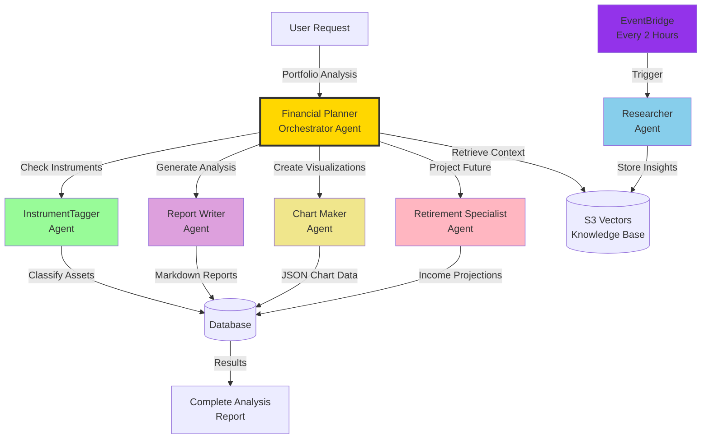
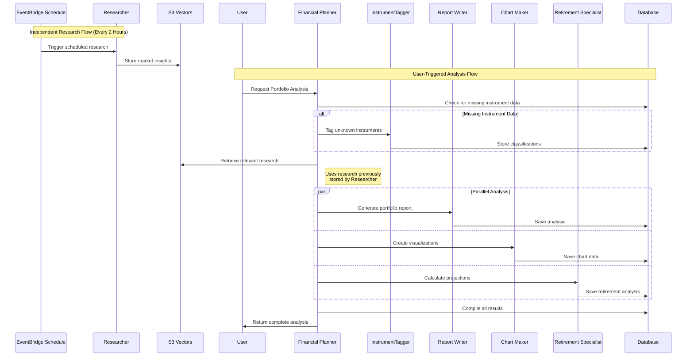

# Agent Architecture

This document describes how the AI agents in Portfolio Pilot collaborate to turn a user's raw portfolio data into a full financial analysis.

## Agent Collaboration Overview

## Agent Responsibilities

### Financial Planner (Orchestrator)

**Role**: coordinates the entire analysis workflow
- Receives analysis requests over SQS
- Identifies missing instrument data and delegates to InstrumentTagger
- Fans out work to the specialist agents in parallel
- Retrieves relevant context from the S3 Vectors knowledge base
- Compiles the final result and updates job status throughout

### InstrumentTagger

**Role**: automatically classifies financial instruments
- Determines asset class (equity, fixed income, etc.), region, and sector exposure
- Uses structured outputs for a consistent, parseable format
- Runs only when the database is missing data for a given symbol

### Researcher (independent agent)

**Role**: autonomously gathers market intelligence
- Runs on an EventBridge schedule (every 2 hours), independent of user requests
- Browses financial sources for market trends, earnings, and economic indicators
- Writes findings into the S3 Vectors knowledge base
- That knowledge is later retrieved by the Financial Planner for context

### Report Writer

**Role**: generates the narrative portfolio analysis
- Analyzes composition, diversification, and risk exposure
- Writes an executive summary and detailed markdown report
- Pulls in supporting context from the knowledge base via a tool call

### Chart Maker

**Role**: turns portfolio data into visualizations
- Produces allocation breakdowns by asset class, region, and sector
- Outputs Recharts-compatible JSON (pie, bar, donut charts)
- Returns structured output directly — no tool calls

### Retirement Specialist

**Role**: projects long-term financial outcomes
- Runs Monte Carlo simulations against the user's goals
- Factors in years to retirement and target income
- Produces a success-probability projection plus recommendations

## Agent Communication Flow

## Agent Capabilities Matrix

| Agent | Model | Primary Function | Output Format |
|-------|-------|-------------------|----------------|
| Financial Planner | Amazon Nova Pro | Orchestration & coordination | Job status + compiled result |
| InstrumentTagger | Amazon Nova Pro | Asset classification | Structured JSON |
| Researcher | Bedrock open-weight model | Market intelligence | Markdown articles |
| Report Writer | Amazon Nova Pro | Portfolio narrative | Markdown report |
| Chart Maker | Amazon Nova Pro | Data visualization | Recharts JSON |
| Retirement Specialist | Amazon Nova Pro | Future projections | Analysis + chart data |

## Knowledge Integration

Agents draw on two sources of context:

**S3 Vectors knowledge base** — historical research, earnings analysis, economic indicators, and investment commentary, continuously refreshed by the Researcher.

**Database reference data** — instrument classifications, user portfolios, and prior reports, all validated through Pydantic schemas before being written.

## Agent Collaboration Patterns

1. **Data enrichment**: `Unknown Instrument → InstrumentTagger → Enriched Data → Other Agents`
2. **Independent research**: `EventBridge (every 2 hrs) → Researcher → S3 Vectors → Knowledge Base Growth`
3. **Knowledge integration**: `Financial Planner → Retrieve from S3 Vectors → Contextual Analysis`
4. **Parallel processing**: `Financial Planner → [Report Writer, Chart Maker, Retirement] → Compiled Results`

## Key Design Principles

1. **Specialization** — each agent has one focused responsibility
2. **Orchestration, not micromanagement** — the planner coordinates but leaves execution to the specialists
3. **Parallel execution** — independent agents run simultaneously for speed
4. **Shared knowledge** — the S3 Vectors store gives every agent access to accumulated research
5. **Graceful degradation** — the system keeps working even if one agent's output is missing
6. **Tools XOR structured outputs** — a current LiteLLM/Bedrock limitation means each agent uses either tool calling or structured outputs, never both; see the implementation note in each agent's `agent.py`

## Possible Future Enhancements

- Additional specialist agents (tax optimization, rebalancing, deeper risk analysis)
- Real-time market data integration
- International market coverage and ESG scoring
