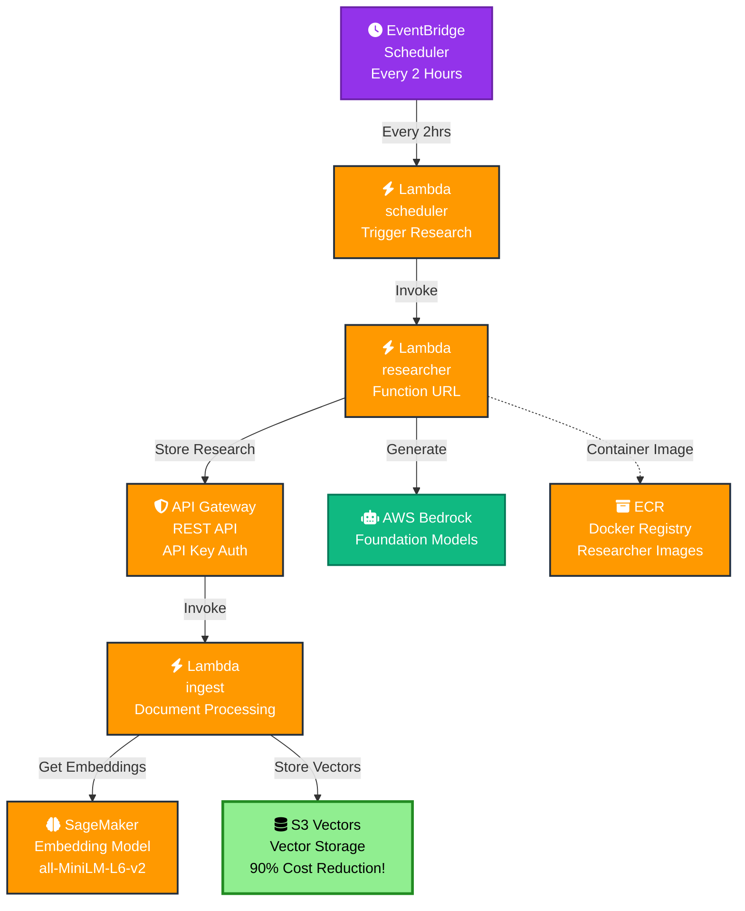
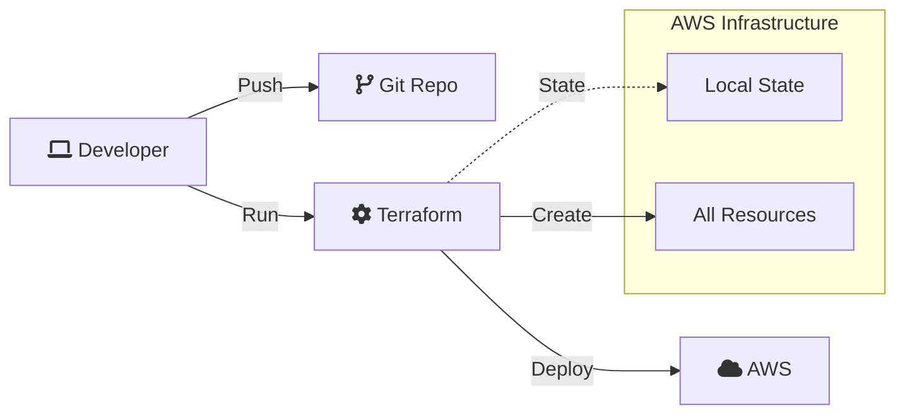

# System Architecture

## Overview

Portfolio Pilot runs on a serverless AWS architecture that combines AI agents with cost-effective infrastructure. There are two independent pipelines: a **research pipeline** that continuously builds a market knowledge base, and an **analysis pipeline** that runs on demand when a user requests a portfolio review (see [agent_architecture.md](agent_architecture.md) for the latter).

## Component Details

### 1. S3 Vectors

- **Purpose**: Native vector storage in S3, used as the knowledge base for research the agents can draw on
- **Features**: sub-second similarity search, automatic optimization, strongly consistent writes
- **Cost**: roughly $20-30/month vs. $200-300/month for a managed OpenSearch cluster
- **Scale**: handles millions of vectors per index

### 2. API Gateway

- **Type**: REST API
- **Auth**: API key authentication
- **Endpoints**: `/ingest` (POST)
- **Purpose**: secure access to the ingest Lambda

### 3. Lambda Functions

- **ingest**: embeds and stores documents in S3 Vectors (Python 3.12, 512MB, 30s timeout)
- **scheduler**: triggers automated research on a schedule (Python 3.11, 128MB, 150s timeout)
- **researcher**: runs the research agent behind a public Lambda Function URL (container image, built from `backend/researcher`)

### 4. SageMaker Serverless

- **Model**: `sentence-transformers/all-MiniLM-L6-v2`
- **Purpose**: generates 384-dimensional embeddings for ingestion and search
- **Memory**: 3GB, scales to zero when idle

### 5. EventBridge Scheduler

- **Schedule**: every 2 hours (configurable, optional)
- **Target**: scheduler Lambda, which invokes the researcher
- **Purpose**: keeps the knowledge base fresh without manual intervention

### 6. AWS Bedrock

- **Provider**: AWS Bedrock
- **Models**: Amazon Nova Pro for the agent orchestra; an open-weight model for the researcher
- **Purpose**: generation and reasoning for every agent in the system
- **Features**: cross-region inference profiles, tool calling, large context windows

## Data Flow

1. **Manual research**: user/API → researcher Lambda → Bedrock (generate) → API Gateway → ingest Lambda → S3 Vectors
2. **Automated research**: EventBridge (every 2 hrs) → scheduler Lambda → researcher Lambda → Bedrock → API Gateway → ingest Lambda → S3 Vectors
3. **Direct ingest**: client → API Gateway → ingest Lambda → SageMaker (embed) → S3 Vectors
4. **Search**: client → API Gateway → ingest Lambda → S3 Vectors (similarity search)

## Cost Optimization

| Component | Monthly Cost | Notes |
|-----------|-------------|-------|
| S3 Vectors | ~$30 | ~90% cheaper than a managed OpenSearch cluster |
| SageMaker Serverless | ~$5-10 | Pay per request, scales to zero |
| Lambda | ~$1 | Minimal invocations |
| Researcher Lambda | ~$5 | Container image, pay per invocation |
| API Gateway | ~$1 | REST API |
| **Total** | **~$42-47** | vs. ~$250+ for a conventional vector-database setup |

## Security Features

- **API Gateway**: API key authentication
- **IAM roles**: least-privilege access per Lambda function
- **S3 Vectors**: always private, no public access
- **Lambda Function URL**: HTTPS by default
- **Secrets**: stored as environment variables / AWS Secrets Manager, never in code

## Deployment Architecture

## Technology Stack

- **Infrastructure**: Terraform (one independent stack per infrastructure area)
- **Compute**: Lambda
- **AI/ML**: SageMaker Serverless, AWS Bedrock
- **Storage**: S3 Vectors, Aurora Serverless v2
- **API**: API Gateway
- **Languages**: Python 3.12
- **Containers**: Docker

See [agent_architecture.md](agent_architecture.md) for how the analysis pipeline — the multi-agent "advisor team" — fits on top of this foundation.
